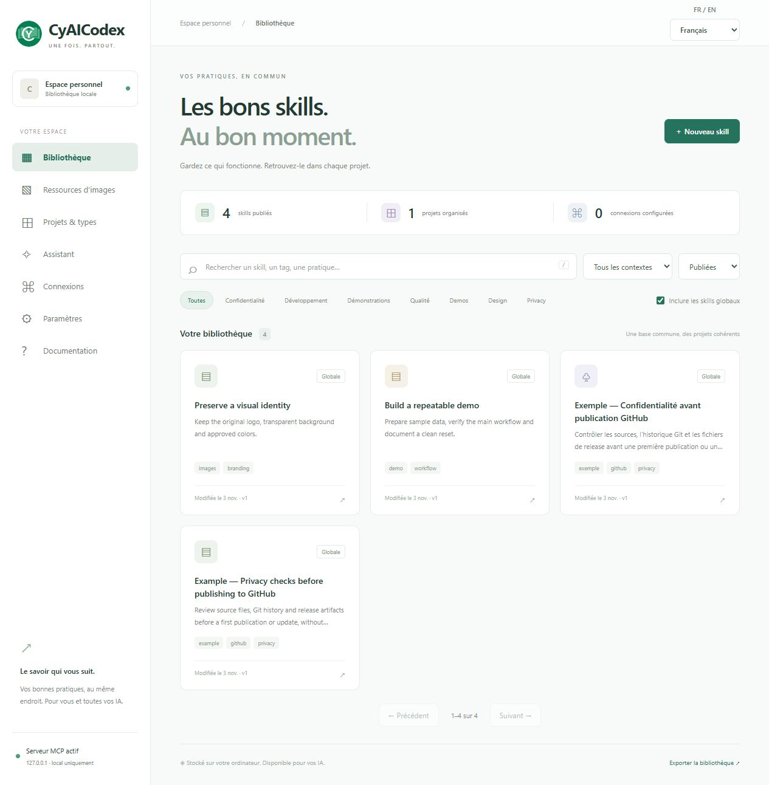
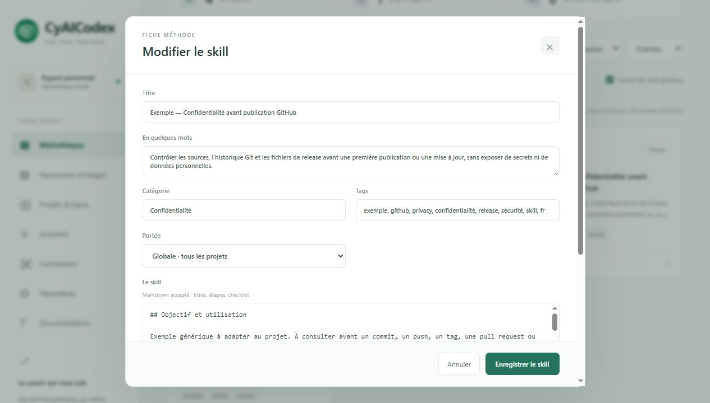
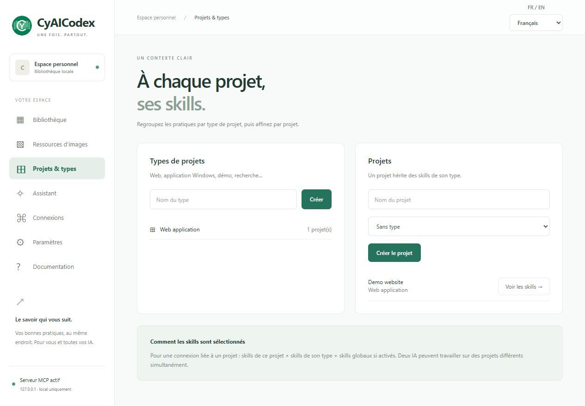

<table width="100%">
  <tr>
    <td width="300" align="left" valign="top">
      <a href="https://mrmybal.github.io/CyAICodex/Documentation.html#/fr/welcome">Manuel</a><br>
      <a href="https://github.com/MrMybal/CyAICodex">Dépôt</a><br>
      <a href="https://github.com/MrMybal/CyAICodex/issues">Signaler un problème</a><br><br>
      <sub>README</sub><br>
      <a href="README.md">English</a> · <a href="README.fr.md">Français</a>
    </td>
    <td width="400" align="center" valign="middle">
      
    </td>
    <td width="300" align="right" valign="top">
      <p><sub>Licence de l’application</sub><br><a href="LICENSE"><strong>AGPL-3.0-only</strong></a></p>
      <p><sub>Version</sub><br><a href="CHANGELOG.fr.md"><strong>0.9.1</strong></a><br><strong>BÊTA</strong></p>
      <p><a href="https://github.com/MrMybal/CyAICodex/releases/download/v0.9.1/CyAICodex-Setup-0.9.1.exe"><strong>Télécharger</strong></a><br><sub>Windows x64 · installateur</sub></p>
    </td>
  </tr>
</table>

<h1 align="center">CyAICodex</h1>
<p align="center">Maintenance : <strong>Cyberalien</strong>.</p>

Une bibliothèque locale partagée de Skills réutilisables et de références visuelles pour travailler avec plusieurs clients IA ou projets. Rédigez une procédure une fois, classez-la par projet et rendez les mêmes ressources publiées accessibles par MCP.

> **BÊTA · 0.9.1**
>
> Une version Windows est disponible pour les essais et retours avant une disponibilité stable. Consultez les [changements et limites documentées](CHANGELOG.fr.md) avant l’installation ou la mise à jour.

[](.CyDocBuild/assets/images/skills-library.fr.jpg)

## À propos de CyAICodex

Créez des Skills avec des consignes Markdown, un résumé, des catégories et des tags. Publiez vos pratiques en portée globale, pour un type de projet ou pour un projet précis ; gardez les travaux en cours en brouillon. Par exemple, enregistrez une checklist de publication GitHub relue et rendez-la accessible aux clients des projets concernés.

Le navigateur sert d’interface. Un processus Windows maintient la bibliothèque et le serveur MCP dans la zone de notification. **Connexions > Configurer et tester** configure Codex, Claude Desktop ou OpenCode. Les autres clients compatibles peuvent utiliser la configuration générée en stdio ou en Streamable HTTP local. Chaque connexion possède sa portée et ses droits de lecture/écriture ; l’accès local sans jeton est un réglage distinct et facultatif. MCP donne accès aux ressources ; les consignes du client déterminent quand une IA les consulte.

[](.CyDocBuild/assets/images/skill-editor.fr.jpg)

Les ressources d’images conservent les originaux PNG, JPEG ou WebP avec descriptions, consignes de préservation et usages autorisés. L’assistant intégré peut utiliser des Skills et images sélectionnés pour préparer du contenu réutilisable. Les intégrations disponibles sont Codex, Claude Code, OpenCode, Ollama, OpenAI API, Claude API, Antigravity, Command Code, CodeBuddy, OpenRouter et LM Studio. Installez et connectez le client requis, ou configurez son serveur/accès API ; compte de l’application et identifiants API peuvent être distincts. La prise en charge des images dépend de l’adaptateur et du modèle ; CyAICodex ne génère pas d’images.

<details>
<summary>Portées des projets</summary>

[](.CyDocBuild/assets/images/project-scopes.fr.jpg)

Une connexion projet peut inclure ce projet, son type et les ressources globales. Les autres projets restent hors portée. Plusieurs clients peuvent utiliser des contextes différents simultanément.

</details>

## Fonctionnalités

- **Skills réutilisables** : recherche plein texte avec normalisation des accents et préfixes, filtres, pagination, historique et protection contre les modifications concurrentes.
- **Accès MCP par portée** : ressources publiées uniquement, connexions nommées, jetons révocables et droits d’écriture propres à chaque connexion.
- **Références visuelles** : originaux préservés, aperçus et consignes d’utilisation avec versions ; une variante d’image est une nouvelle ressource.
- **Assistant intégré** : clients locaux, serveurs de modèles locaux et fournisseurs API ; transformez une réponse relue en brouillon de Skill avant de l’enregistrer.
- **Intégration Windows** : commandes dans la zone de notification, démarrage facultatif à l’ouverture de session et mises à jour GitHub avec contrôle de taille et d’empreinte de l’installateur.
- **Anglais et français** : anglais par défaut, préférence de langue conservée et manuel CyDoc illustré avec recherche, thèmes, F1 et aide contextuelle.

Le [manuel complet](https://mrmybal.github.io/CyAICodex/Documentation.html#/fr/welcome) couvre installation, fournisseurs, droits, sauvegardes et API MCP publique. Le même lecteur est installé dans `Documentation/Documentation.html` avec son dossier `DocData/` ; sa lecture ne nécessite ni serveur ni Internet.

---

## Installation

L’installateur publié cible **Windows x64**. L’environnement Python nécessaire est inclus. Node.js sert uniquement à générer la documentation ; aucun des deux ne doit être installé séparément pour utiliser cette version.

1. [Téléchargez CyAICodex-Setup-0.9.1.exe](https://github.com/MrMybal/CyAICodex/releases/download/v0.9.1/CyAICodex-Setup-0.9.1.exe). Les [notes et empreintes SHA-256](https://github.com/MrMybal/CyAICodex/releases/tag/v0.9.1) l’accompagnent.
2. Lancez l’installateur. Il propose un raccourci sur le bureau et le démarrage avec Windows.
3. Ouvrez **CyAICodex** depuis Démarrer, le raccourci ou l’icône verte CY avec un livre, puis configurez les clients souhaités dans **Connexions**.

Changez la langue dans **FR / EN** ou **Paramètres > Langue de l’application**. Les préférences déjà enregistrées sont conservées ; vos Skills et descriptions d’images ne sont pas traduits automatiquement.

Fermer le navigateur laisse le serveur actif. Le menu de l’icône permet de le rouvrir ou de **Quitter et arrêter le serveur**. Le démarrage a lieu après la connexion Windows ; le PC doit rester éveillé pour que les clients locaux accèdent au serveur. Conservez les dossiers installés `_internal/` et `Documentation/` à côté de `CyAICodex.exe`.

Votre bibliothèque installée se trouve dans `%LOCALAPPDATA%\CyAICodex\data` et reste conservée après désinstallation. Pour une sauvegarde complète, arrêtez l’application et copiez tout ce dossier ; l’export JSON contient uniquement les Skills et leur classement. La [sauvegarde et restauration](https://mrmybal.github.io/CyAICodex/Documentation.html#/fr/backup) explique aussi le chiffrement lié au compte Windows et la migration d’une version portable.

**Paramètres > Mises à jour** vérifie les releases GitHub automatiquement si l’option est active ; l’installation reste une action distincte. Un dépôt privé peut utiliser les identifiants Git locaux ou un jeton limité au dépôt. Les requêtes de l’assistant transmettent conversation et références sélectionnées au fournisseur choisi. La page [droits et confidentialité](https://mrmybal.github.io/CyAICodex/Documentation.html#/fr/permissions) détaille ces réglages.

## Sources, compilation et bibliothèques nécessaires

<details>
<summary>Compiler ou lancer depuis les sources</summary>

Utilisez **Windows x64, Python 3.11+, Node.js 22+ et npm**. Git récupère les sources. Inno Setup 6 est nécessaire pour produire l’installateur. Les dépendances Python sont figées dans [requirements.lock.txt](requirements.lock.txt) ; celles de la documentation dans [.CyDocBuild/package-lock.json](.CyDocBuild/package-lock.json).

```powershell
git clone https://github.com/MrMybal/CyAICodex.git
cd CyAICodex
.\Install.ps1
npm ci --prefix .CyDocBuild
npm --prefix .CyDocBuild run build
.\.venv\Scripts\python.exe run.py --port 18765
```

Le port distinct permet de conserver une version installée en parallèle. Les données de la version source se trouvent par défaut dans le dossier `data/` du dépôt.

Pour l’exécutable et l’installateur Windows :

```powershell
.\Build-App.ps1
.\Build-Installer.ps1
```

`Build-Installer.ps1` lance aussi le build de l’application ; il peut être utilisé seul. Si Inno Setup est installé ailleurs que dans les emplacements habituels, indiquez le chemin du compilateur avec `-Iscc`. L’application est produite dans `dist/CyAICodex/` et l’installateur dans `dist/`.

La génération documentaire active uniquement le module image de CyDoc ; les schémas sont compilés en SVG et Three.js n’est pas installé. Les [instructions de génération documentaire](.CyDocBuild/README.md) décrivent régénération et traductions. Les clients CLI et modèles locaux s’installent séparément ; ils ne sont pas inclus dans CyAICodex. [Install-Clients.ps1](Install-Clients.ps1) permet d’installer les versions figées de Claude Code et OpenCode via npm.

</details>

---

## Licence

CyAICodex utilise la [GNU Affero General Public License, version 3 uniquement](LICENSE) (`AGPL-3.0-only`). Copyright © 2026 Cyberalien. Les composants tiers conservent leurs propres conditions.

### Bibliothèques tierces et outils de compilation

| Bibliothèque · sources | Licence · texte | Utilisation / périmètre |
| --- | --- | --- |
| [CPython 3.11](https://github.com/python/cpython) | [PSF et notices des composants](https://docs.python.org/3.11/license.html) | Interpréteur Python inclus dans la version Windows. |
| [SQLite](https://sqlite.org/) | [Domaine public](https://sqlite.org/copyright.html) | Base locale et recherche plein texte via Python. |
| [MCP Python SDK 1.30.0](https://github.com/modelcontextprotocol/python-sdk) | [MIT](https://github.com/modelcontextprotocol/python-sdk/blob/v1.30.0/LICENSE) | Transports serveur et clients MCP à l’exécution. |
| [FastAPI 0.141.1](https://github.com/fastapi/fastapi) | [MIT](https://github.com/fastapi/fastapi/blob/0.141.1/LICENSE) | Interface HTTP locale de l’application. |
| [Uvicorn 0.52.4](https://github.com/Kludex/uvicorn) | [BSD-3-Clause](https://github.com/Kludex/uvicorn/blob/0.52.4/LICENSE.md) | Serveur ASGI local. |
| [HTTPX 0.28.1](https://github.com/encode/httpx) | [BSD-3-Clause](https://github.com/encode/httpx/blob/0.28.1/LICENSE.md) | Requêtes HTTP des fournisseurs, de MCP et des mises à jour. |
| [Pydantic 2.13.5](https://github.com/pydantic/pydantic) | [MIT](https://github.com/pydantic/pydantic/blob/v2.13.5/LICENSE) | Validation des fiches et requêtes. |
| [Pillow 12.3.0](https://github.com/python-pillow/Pillow) | [MIT-CMU](https://github.com/python-pillow/Pillow/blob/12.3.0/LICENSE) | Images, aperçus et icône Windows ; les codecs inclus conservent leurs notices. |
| [pystray 0.19.5](https://github.com/moses-palmer/pystray) | [LGPL-3.0](https://github.com/moses-palmer/pystray/blob/v0.19.5/COPYING.LGPL) | Intégration à la zone de notification Windows. |
| [pywin32 312](https://github.com/mhammond/pywin32) | [PSF et notices des composants](https://github.com/mhammond/pywin32/blob/b312/win32/License.txt) | Accès aux API Windows ; certains composants ont leurs propres conditions. |
| [tomlkit 0.15.1](https://github.com/python-poetry/tomlkit) | [MIT](https://github.com/python-poetry/tomlkit/blob/0.15.1/LICENSE) | Lecture et modification des configurations client TOML prises en charge. |
| [json5 0.15.0](https://github.com/dpranke/pyjson5) | [Apache-2.0 et notices des composants](https://github.com/dpranke/pyjson5/blob/v0.15.0/LICENSE) | Lecture des configurations client JSON5/JSONC ; les fichiers de mesure en amont ont leurs propres notices. |
| [CyDoc 0.1.0](https://github.com/MrMybal/CyDoc) | [MIT](.CyDocBuild/vendor/LICENSE) | Lecteur du manuel et d’images embarqué, et génération documentaire. |
| [marked 17.0.6](https://github.com/markedjs/marked) | [MIT](https://github.com/markedjs/marked/blob/v17.0.6/LICENSE.md) | Compilation Markdown lors de la génération. |
| [PrismJS 1.30.0](https://github.com/PrismJS/prism) | [MIT](https://github.com/PrismJS/prism/blob/v1.30.0/LICENSE) | Coloration du code lors de la génération. |
| [esbuild 0.25.12](https://github.com/evanw/esbuild) | [MIT](https://github.com/evanw/esbuild/blob/v0.25.12/LICENSE.md) | Assemblage des scripts documentaires lors du build. |
| [PyInstaller 6.22.3](https://github.com/pyinstaller/pyinstaller) | [GPL-2.0-or-later et exception du lanceur](https://github.com/pyinstaller/pyinstaller/blob/v6.22.3/COPYING.txt) | Outil de packaging Windows et lanceur distribué. |
| [Inno Setup 6](https://jrsoftware.org/isinfo.php) | [Inno Setup License](https://jrsoftware.org/files/is/license.txt) | Compilateur d’installateur Windows ; nécessaire uniquement pour les produire. |
| [pytest 9.1.1](https://github.com/pytest-dev/pytest) | [MIT](https://github.com/pytest-dev/pytest/blob/9.1.1/LICENSE) | Tests de développement, exclus de l’application distribuée. |

Ce tableau présente les composants principaux, pas toutes les dépendances transitives. Conservez les notices complètes des licences et composants fournies avec les dépendances et la distribution ; la licence MIT de CyDoc ne remplace pas l’AGPL de CyAICodex. Les clients IA externes et services fournisseurs ont des conditions distinctes.

## Références et liens

- [Vitrine de l’application — génération et aperçu local](website/README.md), avec présentation anglais/français et manuel HTML complet.
- [Manuel en français](https://mrmybal.github.io/CyAICodex/Documentation.html#/fr/welcome) · [English manual](https://mrmybal.github.io/CyAICodex/Documentation.html#/en/welcome).
- [Changements et limites](CHANGELOG.fr.md) · [Versions publiées](https://github.com/MrMybal/CyAICodex/releases).
- [Dépôt des sources](https://github.com/MrMybal/CyAICodex) · [Suivi des problèmes](https://github.com/MrMybal/CyAICodex/issues).
- [Connexion des clients](https://mrmybal.github.io/CyAICodex/Documentation.html#/fr/mcp) · [Fournisseurs](https://mrmybal.github.io/CyAICodex/Documentation.html#/fr/providers) · [Dépannage](https://mrmybal.github.io/CyAICodex/Documentation.html#/fr/troubleshooting).

<details>
<summary><strong>AI Usage</strong></summary>

- [Guide IA pour la documentation et la connexion](https://mrmybal.github.io/CyAICodex/DocAI.md) — métadonnées documentaires publiques et aide de connexion bilingue, séparées du lecteur humain.
- [Générer la documentation de cette application](.CyDocBuild/README.md) — organisation des sources, génération, traductions et extraction de l’API publique.

</details>
