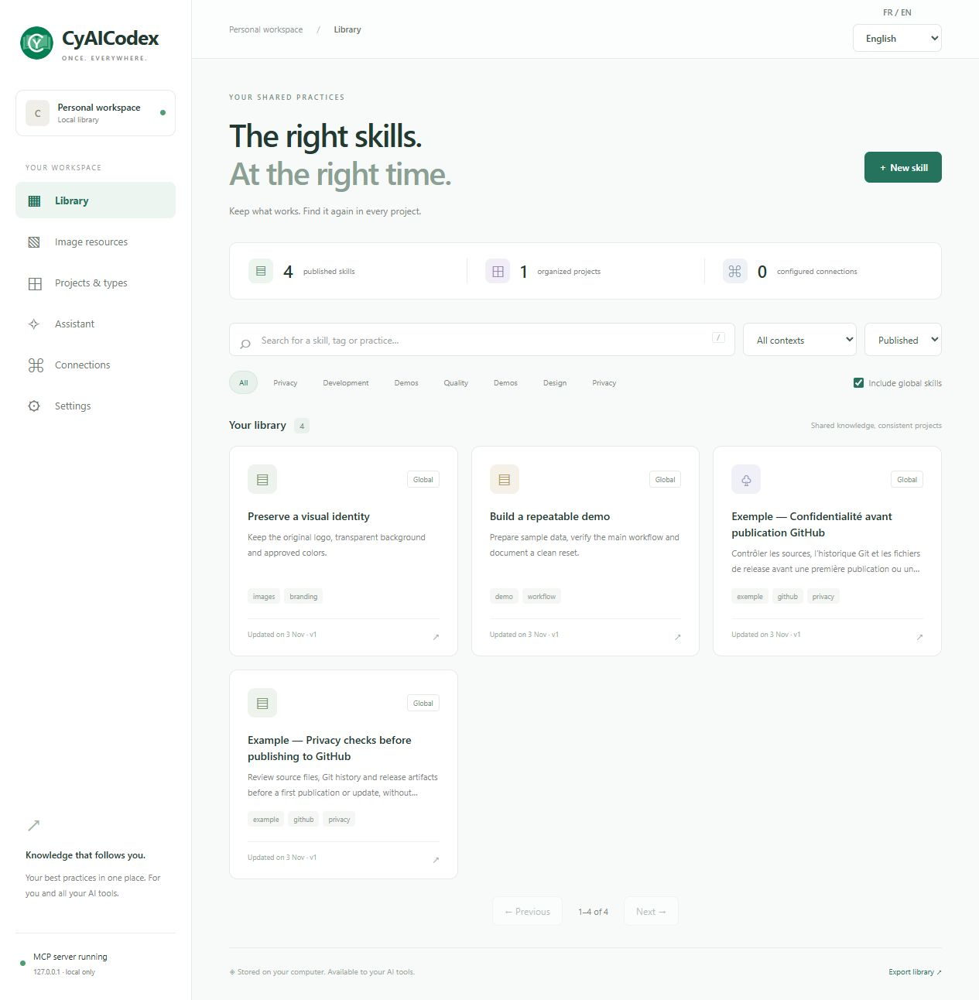
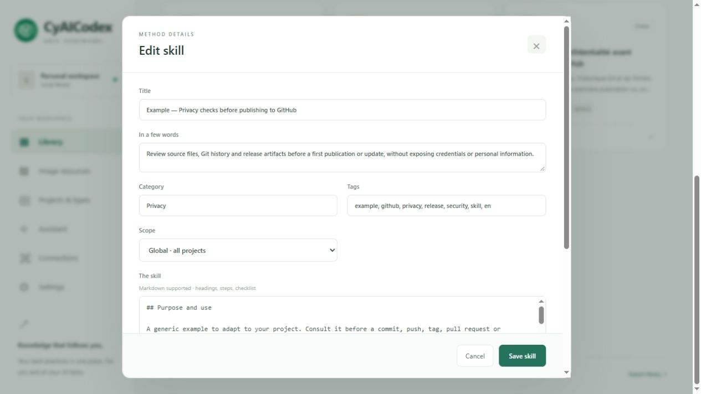
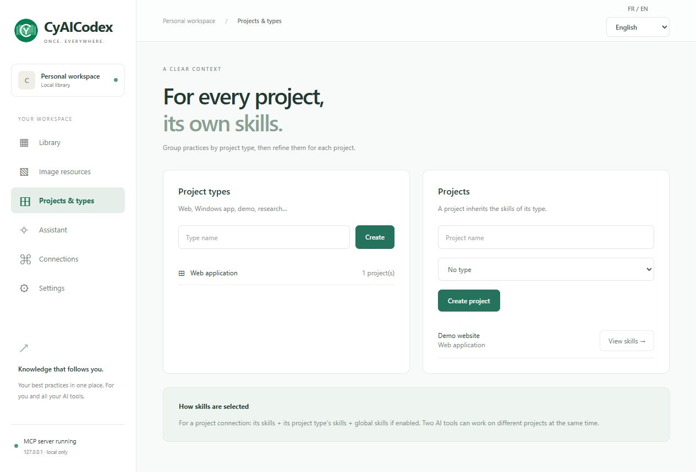

<table width="100%">
  <tr>
    <td width="300" align="left" valign="top">
      <a href="https://mrmybal.github.io/CyAICodex/Documentation.html#/en/welcome">Manual</a><br>
      <a href="https://github.com/MrMybal/CyAICodex">Repository</a><br>
      <a href="https://github.com/MrMybal/CyAICodex/issues">Report an issue</a><br><br>
      <sub>README</sub><br>
      <a href="README.md">English</a> · <a href="README.fr.md">Français</a>
    </td>
    <td width="400" align="center" valign="middle">
      
    </td>
    <td width="300" align="right" valign="top">
      <p><sub>Application license</sub><br><a href="LICENSE"><strong>AGPL-3.0-only</strong></a></p>
      <p><sub>Version</sub><br><a href="CHANGELOG.md"><strong>0.9.1</strong></a><br><strong>BETA</strong></p>
      <p><a href="https://github.com/MrMybal/CyAICodex/releases/download/v0.9.1/CyAICodex-Setup-0.9.1.exe"><strong>Download</strong></a><br><sub>Windows x64 · installer</sub></p>
    </td>
  </tr>
</table>

<h1 align="center">CyAICodex</h1>
<p align="center">Maintained by <strong>Cyberalien</strong>.</p>

A shared local library of reusable Skills and image references for people working with several AI clients or projects. Write a procedure once, organize it by project, and make the same published resources available through MCP.

> **BETA · 0.9.1**
>
> A Windows build is available for testing and feedback before stable availability. Read the [changes and documented limitations](CHANGELOG.md) before installing or updating.

[](.CyDocBuild/assets/images/skills-library.jpg)

## About CyAICodex

Create Skills with Markdown instructions, a summary, categories and tags. Publish shared practices globally, for a project type or for one project; keep work in progress as drafts. For example, store a reviewed GitHub publication checklist once and make it available to the clients working on the relevant projects.

The browser is the interface. A Windows process keeps the library and MCP server running in the notification area. **Connections > Configure and test** configures Codex, Claude Desktop or OpenCode. Other compatible clients can use the generated configuration over stdio or local Streamable HTTP. Each connection has its own scope and read/write permissions; optional token-free local access is a separate setting. MCP provides access to the resources; client instructions determine when an agent consults them.

[](.CyDocBuild/assets/images/skill-editor.jpg)

Image resources keep PNG, JPEG or WebP originals with descriptions, preservation rules and permitted uses. The integrated assistant can use selected Skills and images to draft reusable content. Supported integrations are Codex, Claude Code, OpenCode, Ollama, OpenAI API, Claude API, Antigravity, Command Code, CodeBuddy, OpenRouter and LM Studio. Install and sign in to the required client, or configure its server/API access; desktop accounts and API credentials can be separate. Image support depends on the adapter and model, and CyAICodex does not generate images.

<details>
<summary>Project scopes</summary>

[](.CyDocBuild/assets/images/project-scopes.jpg)

A project connection can include that project, its type and global resources. Other projects stay outside its scope. Multiple clients can use different contexts simultaneously.

</details>

## Features

- **Reusable Skills:** full-text search with accent normalization and prefixes, filters, pagination, revision history and concurrent-edit protection.
- **Scoped MCP access:** published resources only, named connections, revocable tokens and per-connection write permissions.
- **Image references:** preserved originals, visual previews and versioned usage instructions; an image variant is a new resource.
- **Integrated assistant:** local clients, local model servers and API providers; turn a reviewed answer into a draft Skill before saving.
- **Windows integration:** tray controls, optional startup at user sign-in and updates from GitHub releases with installer size/digest checks.
- **English and French:** English by default, saved language preferences and an illustrated CyDoc manual with search, themes, F1 and contextual help.

The [full manual](https://mrmybal.github.io/CyAICodex/Documentation.html#/en/welcome) covers setup, providers, permissions, backups and the public MCP API. The same reader is installed at `Documentation/Documentation.html` with its `DocData/` folder; reading it requires no server or Internet connection.

---

## Installation

The published installer is for **Windows x64**. The required Python runtime is bundled. Node.js is needed only to build the documentation; neither needs a separate installation to use this release.

1. [Download CyAICodex-Setup-0.9.1.exe](https://github.com/MrMybal/CyAICodex/releases/download/v0.9.1/CyAICodex-Setup-0.9.1.exe). [Release notes and SHA-256 checksums](https://github.com/MrMybal/CyAICodex/releases/tag/v0.9.1) accompany it.
2. Run the installer. It offers a desktop shortcut and startup with Windows.
3. Open **CyAICodex** from the Start menu, shortcut or green CY book icon, then configure the clients you want in **Connections**.

Use **FR / EN** or **Settings > App language** to change language. Existing language preferences are preserved; your own Skills and image descriptions are not automatically translated.

Closing the browser leaves the server running. Use the tray menu to reopen it or **Quit and stop server**. Startup occurs after Windows sign-in; the PC must stay awake for local clients to connect. Keep the installed `_internal/` and `Documentation/` folders beside `CyAICodex.exe`.

Your installed library is stored in `%LOCALAPPDATA%\CyAICodex\data` and survives uninstalling. For a complete backup, stop the app and copy that entire folder; the JSON export covers Skills and classification only. [Backup and restore](https://mrmybal.github.io/CyAICodex/Documentation.html#/en/backup) also explains Windows-bound encrypted credentials and portable migration.

**Settings > Updates** checks GitHub releases automatically when enabled; installation remains a separate action. Private repository access can use local Git credentials or a limited repository token. Assistant requests send the conversation and selected references to the chosen provider. [Permissions and privacy](https://mrmybal.github.io/CyAICodex/Documentation.html#/en/permissions) explains these controls.

## Source, build and required libraries

<details>
<summary>Build or run from the source checkout</summary>

Use **Windows x64, Python 3.11+, Node.js 22+ and npm**. Git retrieves the source. Inno Setup 6 is needed to produce the installer. Python dependencies are pinned in [requirements.lock.txt](requirements.lock.txt); documentation dependencies are pinned in [.CyDocBuild/package-lock.json](.CyDocBuild/package-lock.json).

```powershell
git clone https://github.com/MrMybal/CyAICodex.git
cd CyAICodex
.\Install.ps1
npm ci --prefix .CyDocBuild
npm --prefix .CyDocBuild run build
.\.venv\Scripts\python.exe run.py --port 18765
```

The alternative port lets a source instance coexist with an installed copy. Source data defaults to the checkout's `data/` folder.

For the Windows executable and installer:

```powershell
.\Build-App.ps1
.\Build-Installer.ps1
```

`Build-Installer.ps1` also runs the application build; it can be used on its own. If Inno Setup is outside its usual location, supply the compiler path with `-Iscc`. The application is written to `dist/CyAICodex/` and the installer to `dist/`.

The documentation build includes only CyDoc's image module; diagrams compile to SVG and Three.js is not installed. [Documentation build instructions](.CyDocBuild/README.md) describe regeneration and translations. Client CLIs and local models are separate installations, not bundled with CyAICodex. [Install-Clients.ps1](Install-Clients.ps1) can install the pinned Claude Code and OpenCode clients through npm.

</details>

---

## License

CyAICodex uses the [GNU Affero General Public License, version 3 only](LICENSE) (`AGPL-3.0-only`). Copyright © 2026 Cyberalien. Third-party components retain their own terms.

### Third-party libraries and build tools

| Library · source | License · terms | Use / scope |
| --- | --- | --- |
| [CPython 3.11](https://github.com/python/cpython) | [PSF + component notices](https://docs.python.org/3.11/license.html) | Python runtime bundled in the Windows build. |
| [SQLite](https://sqlite.org/) | [Public domain](https://sqlite.org/copyright.html) | Local database and full-text search, through Python. |
| [MCP Python SDK 1.30.0](https://github.com/modelcontextprotocol/python-sdk) | [MIT](https://github.com/modelcontextprotocol/python-sdk/blob/v1.30.0/LICENSE) | MCP server and client transports at runtime. |
| [FastAPI 0.141.1](https://github.com/fastapi/fastapi) | [MIT](https://github.com/fastapi/fastapi/blob/0.141.1/LICENSE) | Local application HTTP interface. |
| [Uvicorn 0.52.4](https://github.com/Kludex/uvicorn) | [BSD-3-Clause](https://github.com/Kludex/uvicorn/blob/0.52.4/LICENSE.md) | Local ASGI server. |
| [HTTPX 0.28.1](https://github.com/encode/httpx) | [BSD-3-Clause](https://github.com/encode/httpx/blob/0.28.1/LICENSE.md) | Provider, MCP and update HTTP requests. |
| [Pydantic 2.13.5](https://github.com/pydantic/pydantic) | [MIT](https://github.com/pydantic/pydantic/blob/v2.13.5/LICENSE) | Validation of records and requests. |
| [Pillow 12.3.0](https://github.com/python-pillow/Pillow) | [MIT-CMU](https://github.com/python-pillow/Pillow/blob/12.3.0/LICENSE) | Images, previews and the tray icon; bundled codecs retain their notices. |
| [pystray 0.19.5](https://github.com/moses-palmer/pystray) | [LGPL-3.0](https://github.com/moses-palmer/pystray/blob/v0.19.5/COPYING.LGPL) | Windows notification-area integration. |
| [pywin32 312](https://github.com/mhammond/pywin32) | [PSF / component notices](https://github.com/mhammond/pywin32/blob/b312/win32/License.txt) | Windows bindings; individual components have their own terms. |
| [tomlkit 0.15.1](https://github.com/python-poetry/tomlkit) | [MIT](https://github.com/python-poetry/tomlkit/blob/0.15.1/LICENSE) | Read and update supported TOML client configuration. |
| [json5 0.15.0](https://github.com/dpranke/pyjson5) | [Apache-2.0 + component notices](https://github.com/dpranke/pyjson5/blob/v0.15.0/LICENSE) | Read JSON5/JSONC client configuration; upstream benchmark files have separate notices. |
| [CyDoc 0.1.0](https://github.com/MrMybal/CyDoc) | [MIT](.CyDocBuild/vendor/LICENSE) | Bundled manual reader, image viewer and documentation generation. |
| [marked 17.0.6](https://github.com/markedjs/marked) | [MIT](https://github.com/markedjs/marked/blob/v17.0.6/LICENSE.md) | Build-time Markdown compilation. |
| [PrismJS 1.30.0](https://github.com/PrismJS/prism) | [MIT](https://github.com/PrismJS/prism/blob/v1.30.0/LICENSE) | Build-time code highlighting. |
| [esbuild 0.25.12](https://github.com/evanw/esbuild) | [MIT](https://github.com/evanw/esbuild/blob/v0.25.12/LICENSE.md) | Documentation script bundling during builds. |
| [PyInstaller 6.22.3](https://github.com/pyinstaller/pyinstaller) | [GPL-2.0-or-later + bootloader exception](https://github.com/pyinstaller/pyinstaller/blob/v6.22.3/COPYING.txt) | Windows packaging tool and distributed bootloader. |
| [Inno Setup 6](https://jrsoftware.org/isinfo.php) | [Inno Setup License](https://jrsoftware.org/files/is/license.txt) | Windows installer compiler; needed only to build installers. |
| [pytest 9.1.1](https://github.com/pytest-dev/pytest) | [MIT](https://github.com/pytest-dev/pytest/blob/9.1.1/LICENSE) | Development tests, excluded from the packaged application. |

This table indexes the main components, not every transitive dependency. Retain the full license and component notices supplied with the dependencies and distribution; CyDoc's MIT license does not change CyAICodex's AGPL license. External AI clients and provider services have separate terms.

## References and links

- [English manual](https://mrmybal.github.io/CyAICodex/Documentation.html#/en/welcome) · [Manuel en français](https://mrmybal.github.io/CyAICodex/Documentation.html#/fr/welcome).
- [Changes and limitations](CHANGELOG.md) · [Published releases](https://github.com/MrMybal/CyAICodex/releases).
- [Source repository](https://github.com/MrMybal/CyAICodex) · [Issue tracker](https://github.com/MrMybal/CyAICodex/issues).
- [Client connection guide](https://mrmybal.github.io/CyAICodex/Documentation.html#/en/mcp) · [Provider reference](https://mrmybal.github.io/CyAICodex/Documentation.html#/en/providers) · [Troubleshooting](https://mrmybal.github.io/CyAICodex/Documentation.html#/en/troubleshooting).

<details>
<summary><strong>AI Usage</strong></summary>

- [Documentation and client-setup AI guide](https://mrmybal.github.io/CyAICodex/DocAI.md) — public documentation metadata and bilingual setup guidance, separate from the human reader.
- [Build this application's documentation](.CyDocBuild/README.md) — source layout, generation, translations and public API extraction.

</details>
